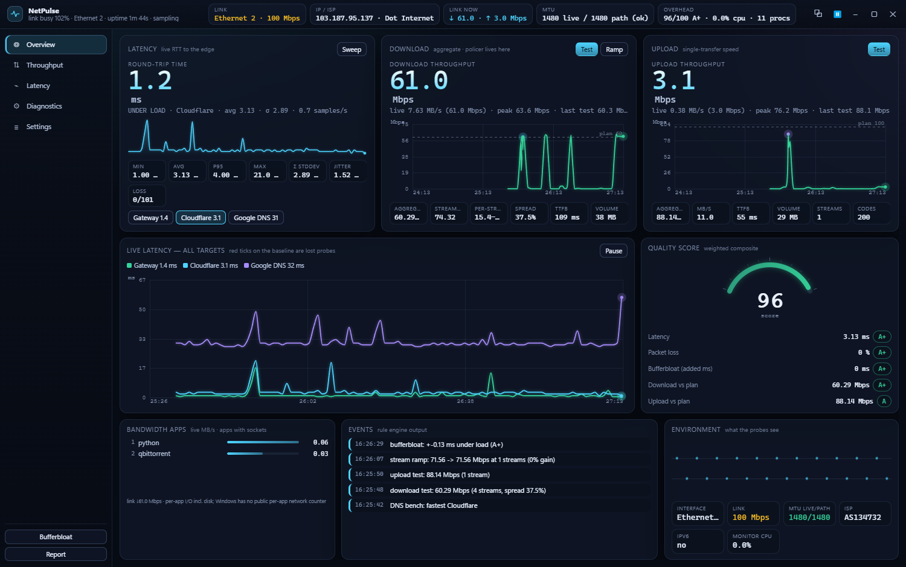
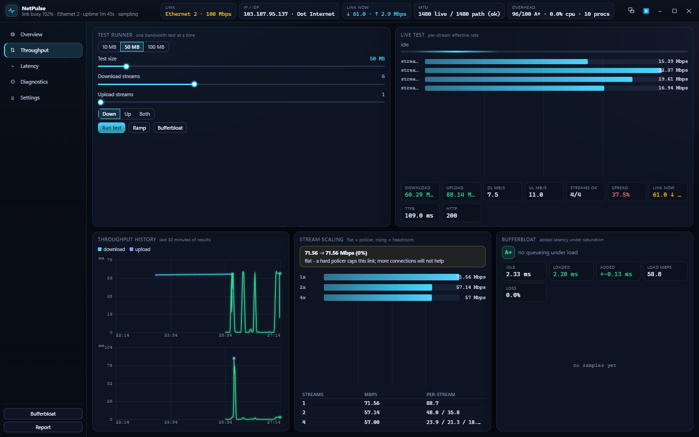
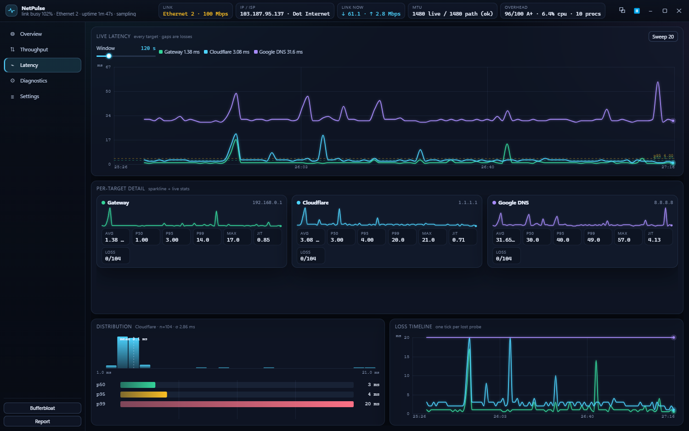
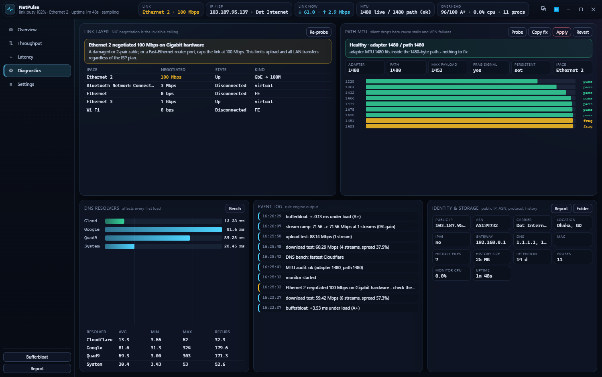
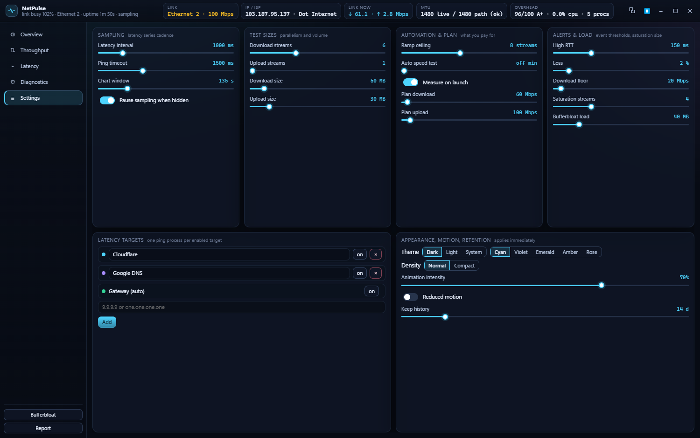
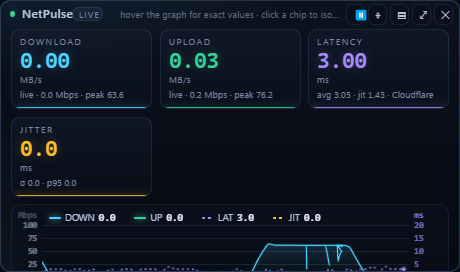
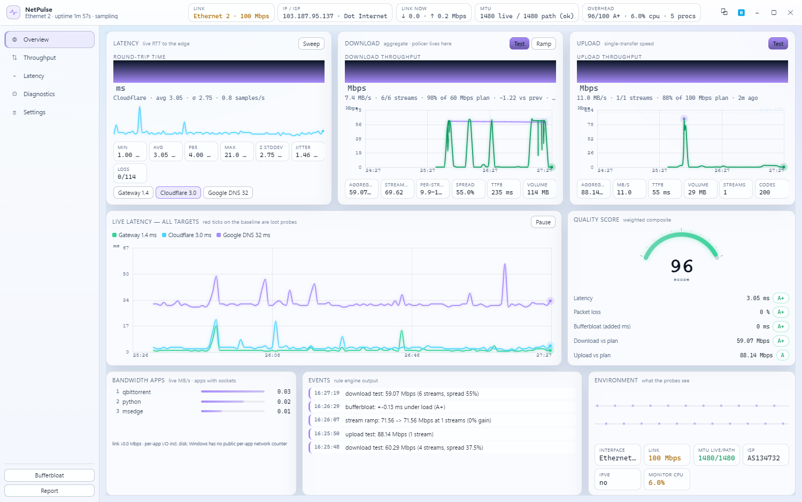
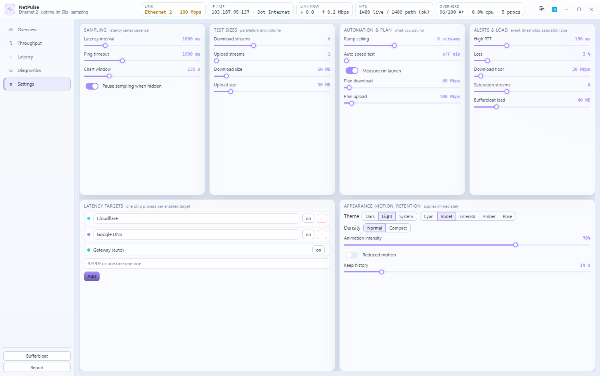

<p align="center">
  
</p>

<h1 align="center">NetPulse</h1>

<p align="center">
  <b>Real-time network observability for your desktop</b><br>
  Latency · Throughput · Jitter · Bufferbloat · DNS · MTU · Link diagnostics — all in one window.
</p>

<p align="center">
  
  
  
  
  
</p>

---

## Why NetPulse?

Most speed test apps give you a single number and disappear. NetPulse stays on your desktop, continuously measuring what matters — and tells you *why* your connection behaves the way it does.

- **Is my ISP throttling me?** The stream-scaling ramp test reveals per-connection policers.
- **Why do video calls stutter?** The bufferbloat grade shows if your router queues packets under load.
- **Which app is eating my bandwidth?** Live per-process I/O ranking names the offender.
- **Is my MTU broken?** DF-ping binary search finds the real path MTU and offers a one-click fix.

Zero runtime dependencies. Zero API keys. Zero chart libraries. Just Electron and raw network probes.

---

## Screenshots

<details open>
<summary><b>🌑 Dark theme</b></summary>

| Overview | Throughput | Latency |
|:---:|:---:|:---:|
|  |  |  |

| Diagnostics | Settings | Gadget |
|:---:|:---:|:---:|
|  |  |  |

</details>

<details>
<summary><b>🌕 Light theme</b></summary>

| Overview | Settings |
|:---:|:---:|
|  |  |

</details>

---

## Features

### 📡 Continuous Monitoring

| Metric | What you get |
|---|---|
| **Latency** | Long-lived `ping` per target — avg, min, max, p50, p95, p99, rolling window, loss ticks |
| **Jitter** | RFC 3550 instantaneous jitter, mean delta, histogram |
| **Download** | Aggregate across N parallel streams, per-stream effective rate, TTFB, plan share |
| **Upload** | Single or multi-stream, sized for 100 Mbps+ links |
| **Bufferbloat** | Idle baseline vs loaded latency, graded **A+ → F** |
| **Stream scaling** | 1→2→4→8 stream ramp — reveals policers vs real capacity |
| **DNS** | Per-resolver timing (Cloudflare / Google / Quad9 / System), uncached-path probe |
| **Path MTU** | DF-ping binary search, adapter MTU, verdict + one-click fix |
| **Link** | NIC list, negotiated speed, Gigabit-stuck-at-100 warning, MAC, gateway, DHCP |
| **Identity** | Public IP, ASN, carrier, IPv6 availability |
| **Quality** | Weighted 0–100 composite score with per-dimension letter grades |
| **Events** | Rule engine: high RTT, loss, speed floor, link renegotiation, MTU change |
| **Bandwidth apps** | Live top-5 MB/s ranking of processes holding sockets |

### 🖥️ Desktop Experience

- **Always-on-top gadget** — a compact floating window with live download, upload, latency, and jitter charts
- **5 dashboard views** — Overview, Throughput, Latency, Diagnostics, Settings
- **Dark & light themes** with 5 accent colors (cyan, violet, emerald, amber, rose)
- **Keyboard navigation** — `1`–`5` for views, `Esc` closes modals
- **Spring animations** with configurable intensity and reduced-motion support
- **Markdown reports** — export a full network audit as Markdown at any time

### ⚡ Under the Hood

- **No chart library** — all graphs are hand-drawn on `<canvas>` for zero-dependency rendering
- **No native modules** — pure JavaScript, portable across Electron versions
- **4 Hz snapshot loop** — probes write into ring buffers; a single tick pushes the renderer
- **Cloudflare speed endpoints** with automatic fallback to OVH / ThinkBroadband on rate-limit
- **Back-pressure scheduling** — only one bandwidth-consuming test runs at a time
- **JSONL history** — one file per day under `data/`, pruned by a configurable retention window

---

## Quick Start

```bash
git clone https://github.com/c0pperfi3ld/netpulse.git
cd netpulse
npm install        # only Electron — no native modules, no chart library
npm start
```

> **Offline?** If `npm install` stalls (OneDrive sync, no internet), restore the cached Electron build:
> ```bash
> npm run fix-electron
> ```

---

## Verify Without the GUI

The measurement core is plain Node — runs headless, no Electron required:

```bash
npm run selftest            # human-readable output
npm run selftest:json       # machine-readable
node scripts/selftest.js --fast   # 10 MB probes (faster)
```

---

## Headless QA

Capture every view as a screenshot and run DOM assertions:

```bash
npm run qa        # writes data/qa/*.png + data/qa/qa-result.json
```

---

## Keyboard Shortcuts

| Key | Action |
|-----|--------|
| `1` | Overview |
| `2` | Throughput |
| `3` | Latency |
| `4` | Diagnostics |
| `5` | Settings |
| `Esc` | Close modal / report |

---

## Architecture

```
netpulse/
├── src/
│   ├── main/              # Electron main process
│   │   ├── index.js        # App lifecycle, IPC, window management
│   │   ├── scheduler.js    # Probe orchestration, ring buffers, events
│   │   ├── store.js        # JSONL persistence, settings, history
│   │   ├── report.js       # Markdown report generator
│   │   ├── measure/        # Individual measurement modules
│   │   │   ├── ping.js      # Long-lived latency streams
│   │   │   ├── throughput.js # Download / upload / ramp / bufferbloat
│   │   │   ├── dns.js       # Per-resolver benchmark
│   │   │   ├── mtu.js       # Path MTU discovery
│   │   │   ├── link.js      # NIC, gateway, ISP identity
│   │   │   ├── quality.js   # Composite quality score
│   │   │   ├── linkRate.js  # Real-time NIC throughput sampling
│   │   │   └── topApps.js   # Per-process bandwidth ranking
│   │   └── util/
│   │       └── proc.js      # Child process management
│   ├── preload/
│   │   └── preload.js      # Context bridge
│   ├── renderer/
│   │   ├── index.html      # Single-page shell
│   │   ├── js/
│   │   │   ├── app.js       # Router, IPC, theme engine
│   │   │   ├── charts.js    # Canvas-based charting (zero dependencies)
│   │   │   ├── gadget.js    # Floating live widget
│   │   │   ├── springs.js   # Spring-physics animations
│   │   │   ├── util.js      # DOM helpers
│   │   │   └── views/       # Overview, Throughput, Latency, Diagnostics, Settings
│   │   └── styles/
│   │       ├── app.css      # Layout and components
│   │       └── tokens.css   # Design tokens (colors, spacing, typography)
│   └── shared/
│       └── constants.js    # Endpoints, defaults, grading tables
├── scripts/
│   ├── selftest.js         # Headless measurement verification
│   └── ensure-electron.js  # Offline Electron recovery
└── data/                   # Runtime data (gitignored samples)
```

---

## Notes & Limits

- **Cloudflare is the throughput target** (`speed.cloudflare.com`). It terminates at your local POP — great for measuring the access link, not a general internet throughput estimate.
- **Upload is a floor, not a ceiling** when the NIC is the limit: a 100 Mbps negotiated link cannot carry more than ~94 Mbps of TCP.
- **MTU fix uses UAC.** The Diagnostics view can apply the fix, but it launches an elevated `netsh` through a UAC prompt — never silently — with a revert button beside it.
- **History** is JSONL under `data/`, one file per day, pruned per the retention setting. Reports land in `data/reports/`.

---

## License

[MIT](LICENSE)

---

<p align="center">
  <sub>Built with Electron · No runtime dependencies · No API keys</sub>
</p>
